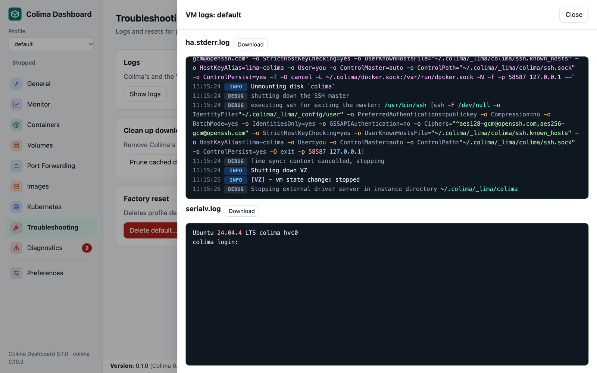

# Colima Dashboard

A lightweight, local web UI for [Colima](https://github.com/abiosoft/colima) on macOS: the everyday
screens of a desktop container app (status, containers, images, volumes, Kubernetes, preferences and
troubleshooting) in one small binary, opened in your browser.

**Status:** early release (0.1.0). See [docs/PLAN.md](docs/PLAN.md).


## Why this instead of Rancher Desktop?

Colima is a fast, free, open source container runtime for macOS, but it is command line only.
Rancher Desktop gives you a window and buttons, at the cost of a much heavier stack. Colima
Dashboard gives Colima the everyday screens of Rancher Desktop and keeps Colima's footprint.

| | Colima + Colima Dashboard | Rancher Desktop 1.25 |
|---|---|---|
| Download | 3 MB dashboard, plus Colima and Lima from Homebrew | 671 MB |
| Installed size | 11 MB dashboard + 10 MB Colima + 108 MB Lima | 1.5 GB app |
| Kubernetes at first start | Off until you tick it | On by default (k3s), first start took 197 s on our Mac |
| Default VM | 2 CPU, 2 GiB | 2 CPU, 6 GB (on a 32 GB Mac) |
| Stop time | being measured now; figures go in the blog post | about 35 s, every run |
| Leftovers after removal | `~/.colima` only | 59 GB of VM data, `~/.rd/bin` and PATH lines in shell profiles on our Mac |
| Admin password | Never | Asked for by some settings |
| Runs as | One Go binary and your browser | Electron app with its own bundled tools |

Rancher Desktop figures are from our own runs on an Apple M5, 32 GB, macOS 27.2, with a fresh
install. The full benchmark (start, stop, idle CPU and memory, builds, file I/O) and its scripts
are in [`bench/`](bench/) and in the blog post this project was written for.

**What you get over plain Colima:**

- Start, stop and restart profiles with a progress view instead of a wall of log lines.
- Containers, images, volumes and port forwards in tables, with start, stop, remove and logs.
- Monitor: live CPU and memory graphs per VM and per container.
- Kubernetes on or off, services list and a reset button.
- Preferences for CPU, memory, disk, runtime, VM type, mount type, Rosetta and new profiles.
- Diagnostics that find the usual Colima problems (missing buildx or credential helper, a
  Rancher Desktop or Docker Desktop still installed, low disk) and show the fix.
- Colour-coded VM, container and job logs.
- Update checks for Colima and for the dashboard, which updates itself.

**When to stay on Rancher Desktop:** you need Windows or Linux, a Kubernetes version picker,
extensions, image scanning, or settings your IT team locks down centrally.

## Screenshots

| Diagnostics, each problem with its fix | Colour-coded VM logs |
|---|---|
|  |  |

| Preferences |
|---|
|  |

## Install

Paste this into Terminal (needs [Homebrew](https://brew.sh)):

```sh
curl -fsSL https://raw.githubusercontent.com/andrewbakercloudscale/colima-dashboard/main/install.sh | bash
```

It installs Colima and the Docker tools with Homebrew (`colima docker docker-compose docker-buildx
docker-credential-helper`), points the docker CLI at compose and buildx, downloads the latest
Colima Dashboard release (checksum verified), starts it now and at every login, and opens
`http://127.0.0.1:7766`. Then press **Start** on the General page to create your first VM.
Add `--kubectl` for kubectl, `--no-service` to skip the login item, `--dry-run` to see the steps
first: `curl -fsSL …/install.sh | bash -s -- --dry-run`.

Colima Dashboard updates itself when a new release is out (untick "Update automatically" on the
General page to stop that). To remove it: `colima-dashboard uninstall-service` and delete the
binary from Homebrew's `bin` folder.

## Build from source

```sh
go build -o colima-dashboard ./cmd/colima-dashboard
./colima-dashboard            # opens http://127.0.0.1:7766 signed in
./colima-dashboard open       # sign a browser in again
./colima-dashboard install-service   # start at login
```

Screens: General, Monitor (live graphs per VM and per container), Containers, Images, Volumes,
Kubernetes, Preferences and Troubleshooting.

- Runs at `http://127.0.0.1:7766`, on this Mac only.
- One Go binary with the page built in; no Electron, no Node, no runtime to install.
- Talks to Colima through its CLI and to Docker through Colima's socket. Changes nothing until you
  press a button, and asks in the page before anything destructive.

Colima Dashboard is an independent project. It is not affiliated with or endorsed by Colima, Rancher
Desktop or SUSE.

## Credits

Some ideas, not code, came from reading two other MIT-licensed Colima front ends:
[vnknowledge2014/colima-ui](https://github.com/vnknowledge2014/colima-ui) (finding the Colima
folder, the PATH a LaunchAgent gets) and [jsynowiec/ColimaUI](https://github.com/jsynowiec/ColimaUI).

## Licence

Apache 2.0. See [LICENSE](LICENSE).
