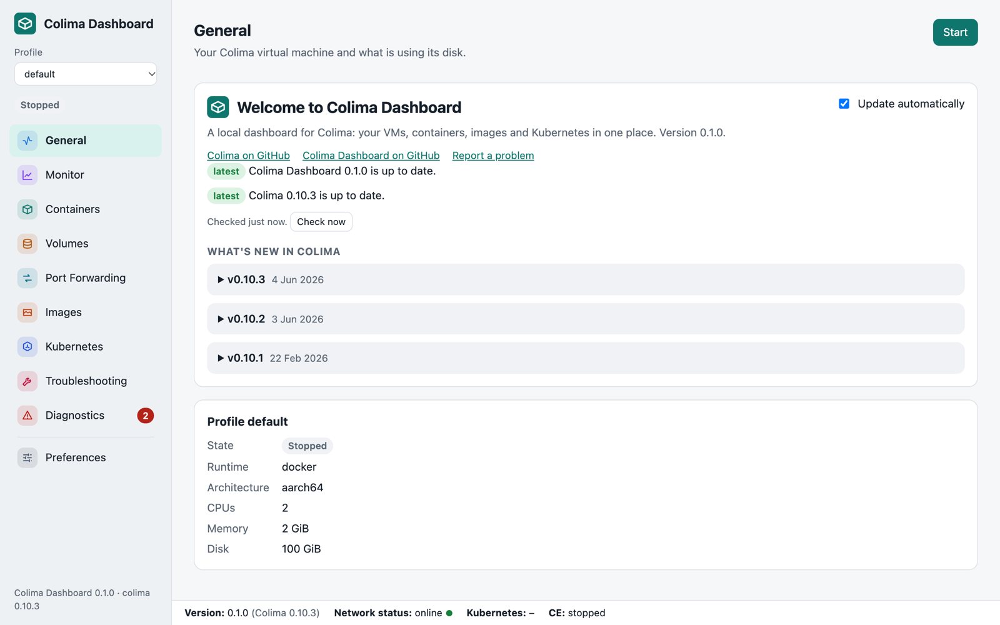
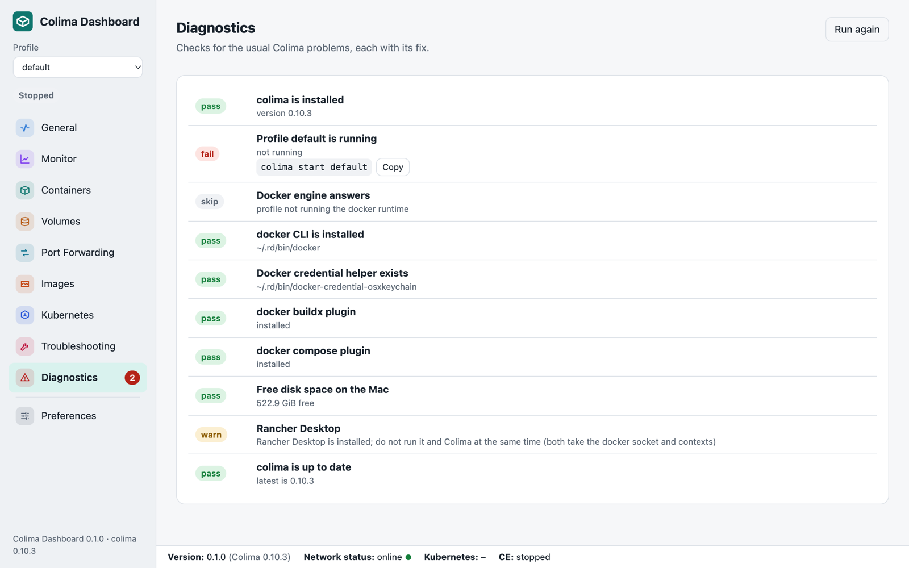
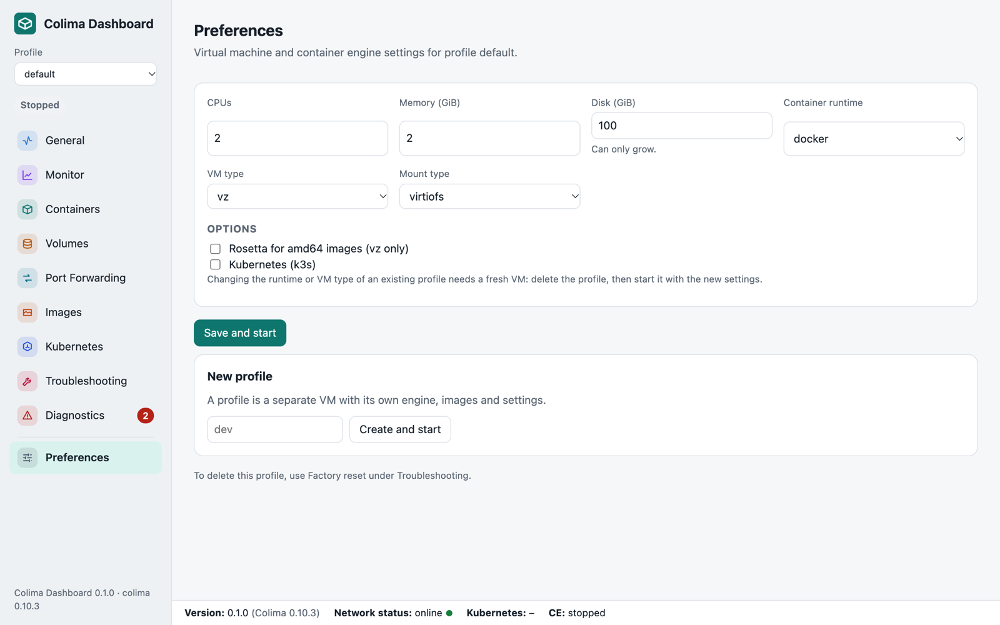

# Colima Dashboard

A lightweight, local web UI for [Colima](https://github.com/abiosoft/colima) on macOS: the everyday
screens of a desktop container app (status, containers, images, volumes, Kubernetes, preferences and
troubleshooting) in one small binary, opened in your browser.

**Install** with one line (macOS, Apple silicon or Intel, needs [Homebrew](https://brew.sh); it installs Colima and the Docker tools too):

```sh
curl -fsSL https://raw.githubusercontent.com/andrewbakercloudscale/colima-dashboard/main/install.sh | bash
```

Then open http://colima.localhost:7766. Details and options are in [Install](#install).

**Status:** early release (0.1.3). See [docs/PLAN.md](docs/PLAN.md).



## Why this instead of Rancher Desktop?

Colima is a fast, free, open source container runtime for macOS, but it is command line only.
Rancher Desktop gives you a window and buttons, at the cost of a much heavier stack. Colima
Dashboard gives Colima the everyday screens of Rancher Desktop and keeps Colima's footprint.

| | Colima + Colima Dashboard | Rancher Desktop 1.25 |
|---|---|---|
| Download | 3 MB dashboard, plus Colima and Lima from Homebrew | 671 MB |
| Installed size | 11 MB dashboard + 10 MB Colima + 108 MB Lima | 1.5 GB app |
| Kubernetes at first start | Off until you tick it | On by default (k3s), first start took 197 s on our Mac |
| Default VM | 2 CPU, 2 GiB | 2 CPU, 6 GB (on a 32 GB Mac) |
| Stop time | about 3 s | about 35 s, every run |
| Leftovers after removal | `~/.colima` only | 59 GB of VM data, `~/.rd/bin` and PATH lines in shell profiles on our Mac |
| Admin password | Never | Asked for by some settings |
| Runs as | One Go binary and your browser | Electron app with its own bundled tools |

Rancher Desktop figures are from our own runs on an Apple M5, 32 GB, macOS 27.2, with a fresh
install. The full benchmark (start, stop, idle CPU and memory, builds, file I/O) and its scripts
are in [`bench/`](bench/) and in the blog post this project was written for.

**What you get over plain Colima:**

- Start, stop and restart profiles with a progress view instead of a wall of log lines.
- Containers, images, volumes and port forwards in tables, with start, stop, remove and logs.
- A shell into any running container in the page, and a file browser to view and download its
  files; volumes can be browsed too, even with no container using them.
- Live stats per container (CPU, memory, network and disk I/O, processes).
- Build an image from a folder on your Mac, push it, or scan it with Trivy.
- Monitor: live CPU and memory graphs per VM and per container, plus 30 days of history.
- Runs and tests and Builds: pass rates, flaky and slowing tests, build times and cache hits.
- Things to fix on the first page: out of memory kills, containers at their limits, a VM short of
  CPU or memory and recent log errors, each with a recommendation and a button to apply it.
- Errors: error and warning lines from every container and Kubernetes pod in one list.
- Report: runs, pass rate, errors, speed changes, resources and what is out of date, as
  Markdown or PDF.
- Kubernetes: on or off, k3s version picker, Traefik on or off, workloads with logs, reset.
- Snapshots: save a stopped profile in a second (APFS clones) and roll back to it.
- A menu bar icon with each profile's state, start and stop, and notifications when a test
  container or a build fails.
- Preferences for CPU, memory, disk, runtime, VM type, mount type, Rosetta and new profiles.
- Diagnostics that find the usual Colima problems (missing buildx or credential helper, a
  Rancher Desktop or Docker Desktop still installed, low disk), each with a button: missing
  tools such as kubectl install in place, the rest run in Terminal. Checks you do not care about can be muted.
- Behind a company proxy that inspects TLS (Zscaler and the like), one click copies your Mac's
  certificate authorities into the VM, so pulls stop failing with x509 errors.
- Start at login, and a light, dark or automatic theme.
- Colour-coded VM, container and job logs.
- Update checks for Colima and for the dashboard, which updates itself.

To see it catch problems by itself, run the stress-ng scenarios in
[examples/stress-ng](examples/stress-ng): a CPU hog, an out of memory test, a failing performance
test and a noisy logger, each of which shows up on the General page within a minute.

**When to stay on Rancher Desktop:** you need Windows or Linux, Docker Desktop extensions, or
settings your IT team locks down centrally.

## Screenshots

| Diagnostics, each problem with its fix | Colour-coded VM logs |
|---|---|
|  |  |

| Preferences |
|---|
|  |

## Install

Paste this into Terminal (needs [Homebrew](https://brew.sh)):

```sh
curl -fsSL https://raw.githubusercontent.com/andrewbakercloudscale/colima-dashboard/main/install.sh | bash
```

It installs Colima and the Docker tools with Homebrew (`colima docker docker-compose docker-buildx
docker-credential-helper`), points the docker CLI at compose and buildx, downloads the latest
Colima Dashboard release (checksum verified), starts it now and at every login, and opens
**http://colima.localhost:7766**. For that easy address it adds one line, `127.0.0.1 colima.localhost`,
to `/etc/hosts`; that is the only step that asks for your Mac password. Skip it and the dashboard is
at `http://127.0.0.1:7766` (the General page has a button to add the name later). Then press **Start** on the General page to create your first VM.
Add `--kubectl` for kubectl, `--no-service` to skip the login item, `--dry-run` to see the steps
first: `curl -fsSL …/install.sh | bash -s -- --dry-run`.

Colima Dashboard updates itself when a new release is out (untick "Update automatically" on the
General page to stop that). To remove it: `colima-dashboard uninstall-service`, delete the
binary from Homebrew's `bin` folder, and remove the `colima.localhost` line from `/etc/hosts`.

## Build from source

```sh
go build -o colima-dashboard ./cmd/colima-dashboard
./colima-dashboard            # opens http://127.0.0.1:7766 signed in
./colima-dashboard open       # sign a browser in again
./colima-dashboard install-service   # start at login
```

Plain `go build` leaves out the menu bar icon, which is Swift: `bash scripts/build-menubar.sh`
then `go build -tags menubar ./cmd/colima-dashboard` includes it (needs the Xcode command line
tools). Release builds always include it.

Screens: General, Monitor (live graphs per VM and per container, plus 1, 7 and 30 day history
with a forecast of when the VM disk fills), Containers (with a shell and a file browser), Runs
and tests (every container run: pass rate, median and slowest times, flaky and slowing tests, out
of memory kills), Builds (build times and cache hit rate per image), Images, Volumes, Port
Forwarding, Kubernetes (version, Traefik, workloads and logs), Snapshots, Errors, Report,
Troubleshooting, Diagnostics and Preferences (including alerts and the menu bar icon).

- Runs at `http://colima.localhost:7766` (or `http://127.0.0.1:7766`), on this Mac only.
- One Go binary with the page built in; no Electron, no Node, no runtime to install.
- Talks to Colima through its CLI and to Docker through Colima's socket. Changes nothing until you
  press a button, and asks in the page before anything destructive.

Colima Dashboard is an independent project. It is not affiliated with or endorsed by Colima, Rancher
Desktop or SUSE.

## Credits

Some ideas, not code, came from reading two other MIT-licensed Colima front ends:
[vnknowledge2014/colima-ui](https://github.com/vnknowledge2014/colima-ui) (finding the Colima
folder, the PATH a LaunchAgent gets) and [jsynowiec/ColimaUI](https://github.com/jsynowiec/ColimaUI).

## Licence

Apache 2.0. See [LICENSE](LICENSE). The in-page terminal is [xterm.js](https://xtermjs.org)
(MIT, `web/vendor/XTERM-LICENSE`), shipped inside the binary.
